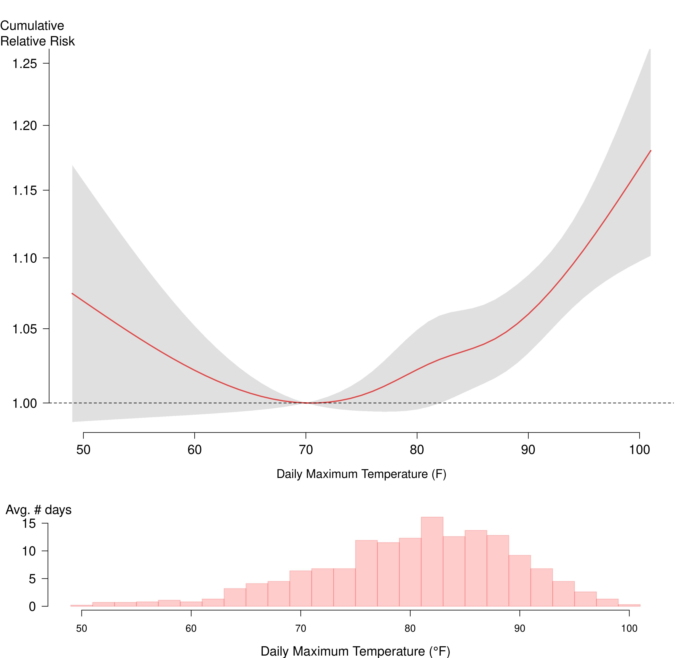

Figure 4: Workplace injury and illness risk increases with heat across most NYC industries <!-- styling if we want to use Extreme Heat Event days, and days at or above 82°F in 10-year moving time windows (e.g., “2023” for 2014-2023). -->

<noscript></noscript>

<strong>Figure 5:</strong> Heat-related injury risk affects workers across NYC, from construction sites to taxis, warehouses, and restaurants. 
