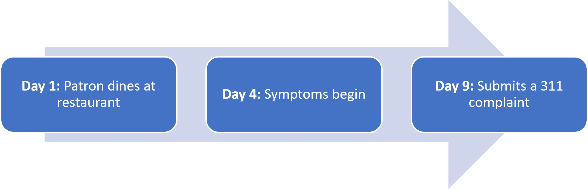
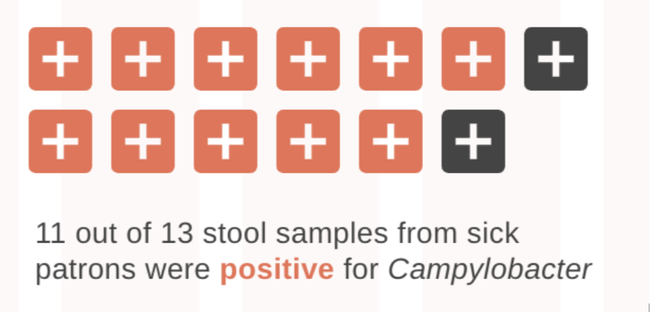

Foodborne illness affects thousands of New Yorkers every year. [A foodborne illness outbreak is when two or more people get sick from consuming food or drink from the same establishment,](data-stories/food-safety-101/) prompting the New York City Health Department to investigate and try to prevent further illness.

<strong>Let’s look at a real foodborne illness outbreak investigation that took place in NYC:</strong>

Two people dined together at a restaurant. Three days later, both diners became very sick. One went to the emergency room and tested positive for Campylobacter, a bacterium that lives in raw or undercooked animal products and can cause gastrointestinal (stomach) illness. Eight days after the dinner, the diner who visited the emergency room called 311 to report both of the illnesses. In addition to seeing a doctor, calling 311 is an important step to take if you think you got sick after eating food from a NYC restaurant.

After receiving the 311 complaint, the Health Department launched an investigation into the potential outbreak.

To begin the investigation, we reached out to the two diners and learned that they both ate several chicken dishes, including chicken liver. Next, we conducted an environmental assessment at the restaurant, reviewing food storage and preparation practices. We found several serious public health problems:

- Chicken was not cooked to 165° Fahrenheit—the minimum required cooking temperature to kill bacteria including Campylobacter – before serving.

- Raw chicken was in contact with cooked chicken, causing cross-contamination, which in this case is the transfer of harmful bacteria from raw chicken to cooked chicken

- The food preparation area had no handwashing sink.

We provided guidance and required the restaurant operator to correct these conditions, and we issued violations subject to fines. We then made a second visit to check whether the restaurant fixed the issues and improved their food preparation practices.

We also contacted other recent restaurant guests to determine whether other patrons got sick after their meals. We conducted 10- to 15-minute interviews with patrons, asking:

- Did anyone in the dining party have gastrointestinal illness symptoms after the meal?

- Did the group share any other meals together before they got sick?

- Which restaurant menu items did everyone eat?

This chart shows how many people were interviewed, had illnesses consistent with Campylobacter infection, and had severe enough symptoms to require hospitalization. After interviewing sick patrons about what they ate, a clear pattern emerged:

<noscript></noscript>

## Diner interviews revealed a clear pattern — everyone who got sick had eaten chicken at the restaurant, and most had eaten chicken liver

Through the interviews we also discovered that people were still getting sick after eating at the restaurant, even after we provided instruction to the restaurant owners on how to correct their practices. This required us to make additional visits to the restaurant to understand why their patrons were still getting sick. Inspectors conducted additonal environmental assessments and did not find any more food safety violations. However, because patrons were still getting sick, the inspectors gathered food invoices to trace where the restaurant’s chicken came from and collected food samples from the restaurant for bacterial testing at the NYC Health Department Public Health Laboratory. We worked with healthcare providers caring for diners who became sick to collect stool samples and brought those to the Public Health Laboratory for analysis, too. These final pieces of evidence confirmed that Campylobacter was the bacteria responsible for the outbreak:

- Food samples from the restaurant’s chicken came back positive for Campylobacter.

- 11 out of 13 stool samples from sick patrons were positive for Campylobacter.

- The time from eating at the restaurant to the appearance of symptoms (called the incubation period) for sick patrons matched the typical incubation period for Campylobacter of 2-5 days.

After combining everything learned from the environmental assessments, diner interviews, and laboratory findings, we determined two main contributing factors for the outbreak:

- Undercooked chicken organ dishes

- Cross-contamination between raw and ready-to-eat chicken

We determined that these issues occurred because of inadequate food preparation and cooking protocols, poor supervision of employees, and lack of attention to food safety.

This was an unusually large and complex outbreak that required multiple visits to the establishment; however, most outbreaks are resolved after a single visit.

## The Health Department can only stop ongoing outbreaks when people report them

This outbreak showed how a 311 complaint and a team of public health investigators can stop foodborne illnesses from continuing. Complaints of food poisoning like the ones about this restaurant are critical for early detection of foodborne illness outbreaks, enabling timely investigation and control measures to prevent others from getting sick.

<noscript></noscript>

As you can see in the chart, the number of food poisoning complaints received each year changes over time. Sometimes these changes are because of how people can report. For example, complaints rose after the launch of the 311 Call line and again after the addition of the <a href="https://portal.311.nyc.gov/article/?kanumber=KA-02051">online portal,</a> which made it easier to submit a complaint. On the other hand, sometimes these yearly changes in complaints reflect actual changes in food poisoning rates from dining out. For example, at the start of the COVID-19 pandemic, when fewer people were eating out, complaints dropped.

Still, many cases are not reported. The spring 2025 New York City Health Opinion Poll estimated that 11% of NYC adults had vomiting or diarrhea in the last 12 months that they believed was caused by food from an NYC eating or drinking establishment. If all of them submitted 311 complaints, we’d expect more than 800,000 reports of foodborne illness – many more than the 4,000 received in 2024.

We rely on public reporting to detect most outbreaks, so your foodborne illness complaint can help protect others.

### How to submit a food poisoning complaint

To submit a food poisoning complaint, you’ll need to include:

- Where and when you ate

- Which foods you ate

- What your symptoms were and if you sought medical care

whether anyone with you became sick or went to see a doctor.

We may ask you a few additional questions that will help us in our investigation, like what else you ate in the three days before you felt ill, since some foodborne illnesses will take a few days to make you sick. Your answers help identify the contaminated dish and can prevent others from getting sick.

<strong>You can report food poisoning complaints to 311 in three ways</strong>

<a href="https://www.cdc.gov/mmwr/volumes/67/ss/ss6710a1.htm">Over half of reported foodborne illness outbreaks nationwide came from restaurant meals.</a>

<strong>There are three main ways food can become unsafe to eat:</strong>

## Report unsafe food practices, too

Even if you haven’t gotten sick, you can also report food safety issues that can lead to foodborne illness, such as:

- Workers touching ready-to-eat food (like cut fruit or vegetables) with bare hands

- Spoiled or contaminated food

- Workers who are sick or not washing their hands

- [food sitting at room temperature for several hours](data-stories/food/)

If you think you got sick from food or see unsafe food practices, report them to 311 to help keep New York safe.
